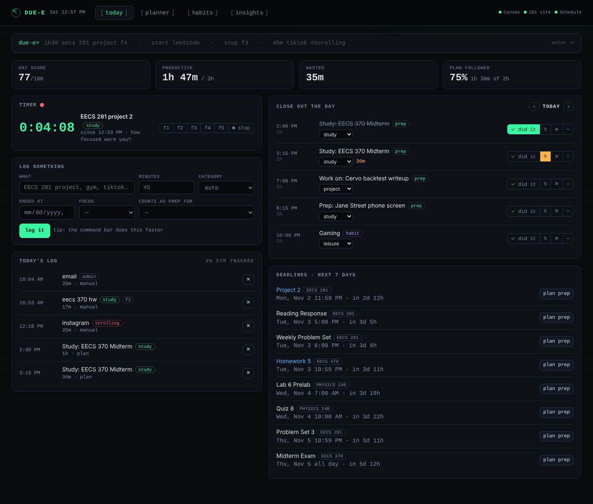
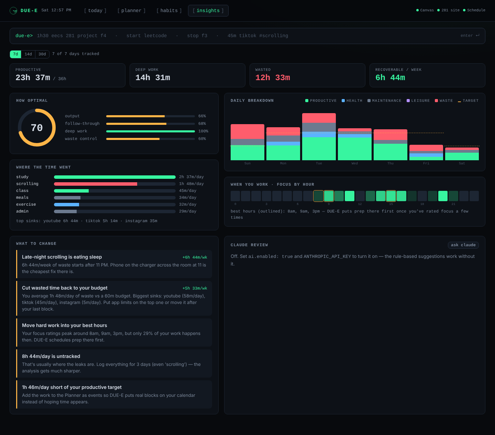
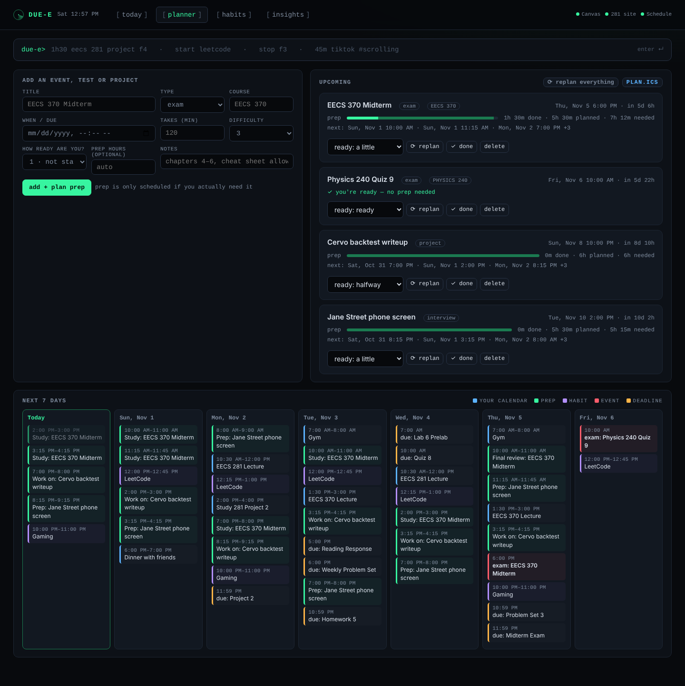

# DUE-E 📡

**Your deadline radar, time tracker and planner.** DUE-E reads your course calendars and posts what's due to Discord. A local web app tracks what you actually do with your time, shows where it leaks, and schedules study prep and habits around your real schedule. Prep only gets scheduled when you need it.

It's also VERA's first patient. DUE-E writes a `status.json` heartbeat for TAL-E and has a `check` command with exit codes for FIX-E.



---

## What it does

| Section | What you get |
|---|---|
| **Radar** (Discord) | A morning post at 8:00 (due today, due tomorrow, later in the next 48h, plus today's plan), an evening post at 20:00 (due tonight, your score so far, and a link to close out the day), and a Sunday post with the week ahead and a week review. Also `/due`. |
| **Tracker** | Log what you did from the web app's command bar, the form, a timer, or Discord (`/log`, `/start`, `/stop`). At the end of the day, mark each item from your calendar and DUE-E's own blocks as ✓ did it / ½ partial / ✕ skipped / — cancelled. |
| **Insights** | A 0–100 *how optimal* score, where your time went, deep-work hours, which hours you focus best, and a ranked list of **what to change**, each with the hours per week it would save. Claude can optionally add a second opinion. |
| **Planner** | Enter exams, projects, assignments, interviews and presentations. DUE-E works out whether you need prep at all. If you do, it spreads study blocks across the days before, in your best hours, without double-booking anything. Missed prep gets rescheduled. |
| **Habits** | Gym 4×/week in the morning, LeetCode 5×/week, gaming 3×/week in the evening. They're placed on different days and around everything else. Leisure goes after the work, so it's guilt-free. Shows streaks and a "done for the week" check. |
| **plan.ics** | A calendar feed of everything DUE-E planned. Subscribe to it in Google or Apple Calendar. |

## How the smart parts work

**Do you need prep?** `needed = base hours for the type × difficulty × how far you are from ready`, minus prep you've already logged toward it. If that leaves under 30 minutes, nothing gets scheduled.

| type | base hours | | difficulty 1 → 5 | readiness 1 → 5 |
|---|---|---|---|---|
| exam 8 · project 12 · interview 5 · assignment 3 · presentation 3 · event 0 | | | 0.6× → 1.4× | 100% → 0% |

You can always set prep hours yourself. If you change readiness on the event card, it replans.

**Where blocks go.** Free time is your waking window, minus your plan calendar, other events, and blocks DUE-E already placed, with 15-minute buffers around everything. Prep is spread across days so no day gets more than its fair share (spaced practice, not cramming). It lands in your focus windows first. Once you've rated your focus a few times, DUE-E learns your real best hours and uses those instead. Prep stops 1 hour before an exam or 2 hours before a due date, an exam's last block is a **Final review**, and there's a daily cap on prep (4h by default).

**The score.** It's built from four parts. Any part with no data is left out and the rest are rescaled.

| part | weight | what it measures |
|---|---|---|
| output | 40 | productive hours ÷ target (6h weekdays, 3h weekends) |
| follow-through | 25 | the share of planned time you actually did (cancelled items don't count against you) |
| waste control | 20 | full marks while you stay within your waste budget (60 min/day), dropping off as you go over |
| deep work | 15 | the share of productive time spent in focused blocks of 45+ minutes |

**What to change.** It flags time-wasting over budget (naming the biggest sinks), late-night scrolling, fragmented work, plan items you keep skipping (and at what time of day), work happening outside your best hours, untracked time, falling short of your target, and weeks with no rest. Suggestions that overlap are only counted once in "recoverable per week".



## Setup

**1. Install**
```bash
python -m venv .venv && source .venv/bin/activate
pip install -e ".[dev]"
```

**2. Get your calendar links** (treat them like passwords)
- **Canvas** (deadlines): go to Calendar, then click **Calendar Feed** at the bottom right.
- **Your schedule** (`role: plan`): this is where you time-block classes, study and the gym. In Google Calendar, go to Settings → your calendar → *Secret address in iCal format*.
- **Course sites:** look for "Subscribe" or "iCal".
- **Club calendars** (`role: events`): their events show up in the morning post and the web app, but they only block time or show up in **Close out the day** once you tap **going**. A Google "embed" link becomes a feed link like this: `https://calendar.google.com/calendar/ical/<calendar id, with @ as %40>/public/basic.ics`.

**3. Create the Discord bot.** In the [Developer Portal](https://discord.com/developers/applications): New Application → **Bot** → Reset Token. Then go to **OAuth2 → URL Generator**, tick `bot` and `applications.commands`, and the permissions View Channel and Send Messages. Invite the bot to your server. No privileged intents are needed. Copy the channel ID and server ID (turn on Developer Mode, then right-click).

**4. Configure**
```bash
cp .env.example .env                 # token, IDs, feed links (and optionally ANTHROPIC_API_KEY)
cp config.example.yaml config.yaml   # schedule, targets, categories, focus windows
```

**On Windows:** run `test-due-e.ps1` (it creates the virtual environment, installs DUE-E and runs every check), then double-click `run-due-e.bat`.

**5. Run**
```bash
due-e web                    # just the web app → http://127.0.0.1:8787
due-e preview                # this morning's Discord post, printed in the terminal
due-e run --dry-run          # schedule + web app, posts print instead of sending
due-e post --kind test       # sends one real message to your channel, to check the connection
due-e run                    # the real thing: Discord bot + schedule + web app
```

## Using it

**Command bar** (press `/` to focus it):
```
1h30 eecs 281 project f4      log 90 min, focus rating 4 (category auto-detected → study)
45m tiktok #scrolling         log with an explicit category
start leetcode                start a timer (stops any running one)
stop f3                       stop it and rate your focus
help                          show these commands
```

**Daily loop:**
1. The morning post shows deadlines and today's plan.
2. During the day, log or time what you work on.
3. In the evening, open the web app's **Close out the day** list and mark what you actually did. This takes about 30 seconds.
4. On Sunday, you get the week review, and habits and slipped prep are re-placed for the new week.

**Discord commands:**

| Command | What it does |
|---|---|
| `/due [days] [course]` | What's due soon |
| `/log what duration [category] [focus]` | Log something you did |
| `/start what` and `/stop [focus]` | Timer |
| `/today` | Today's score, your top categories, what's still planned |
| `/status` | Feed health and next post times |



## Privacy and security
- All data stays local in `.duee/duee.sqlite3`. Nothing leaves your machine unless you turn on the Claude review, which sends weekly totals only, never your notes or calendar.
- The web app listens only on `127.0.0.1` by default. It **refuses** to listen on any other address without `web.token`, so set a token if you want to reach it from your phone through the homelab. A cross-site form can't post to it, and requests with a forged Host header are rejected.
- Feed links never appear in logs or error messages.

## VERA contract 🤝

**TAL-E** reads `.duee/status.json`. It contains the heartbeat (updated at least once a minute), each feed's health and failure streak, the last time each post went out and whether it worked, and when the next posts are due.

**FIX-E** runs:
```bash
pytest -q                          # 70 tests, offline, uses fixture calendars
due-e check --json                 # exit 0 = ok, 1 = degraded, 2 = down
due-e check --feeds-only --json    # just the feeds (for CI, or when the bot isn't running)
```

## Layout
```
duee/
  feeds.py      .ics → deadlines (Item) and time blocks (CalBlock)
  radar.py      merge, dedupe and filter feeds
  render.py     Discord / terminal text
  scheduler.py  morning, evening and weekly posts
  db.py         SQLite: activities, confirmations, events, blocks, habits
  tracker.py    logging, timers, end-of-day confirmation
  analysis.py   score, breakdowns, suggestions
  planner.py    prep estimates, slot finding, habit scheduling, plan.ics
  ai.py         optional Claude weekly review
  web.py        aiohttp API + security middleware
  static/       the web app (vanilla JS, no build step)
  bot.py        Discord client + slash commands
  status.py     status.json + health check for VERA
```

## Deploy
On a VPS or the homelab: `deploy/due-e.service` is a systemd unit with hardening. Keep `web.host: 127.0.0.1` and put a reverse proxy or Tailscale in front, or bind to `0.0.0.0` with a token.

## Roadmap
- [ ] `/done <item>` to hide a deadline you've already submitted
- [ ] Ping you for anything due within 3 hours
- [ ] Two-way Google Calendar sync (write blocks straight into your calendar)
- [ ] Phone shortcut / PWA for one-tap logging
- [ ] Learn how long things actually take you, and adjust prep estimates to match
